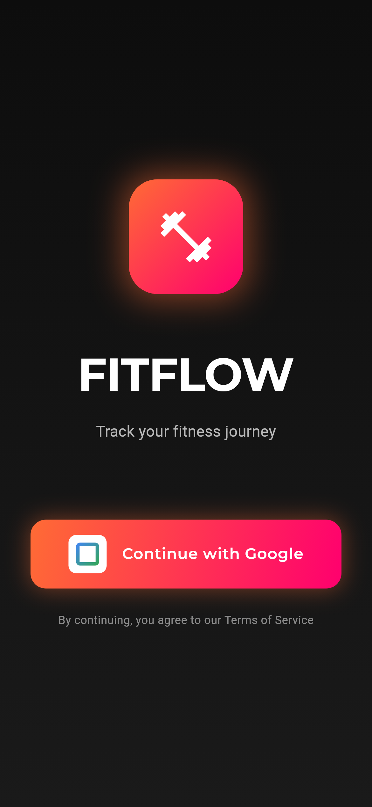
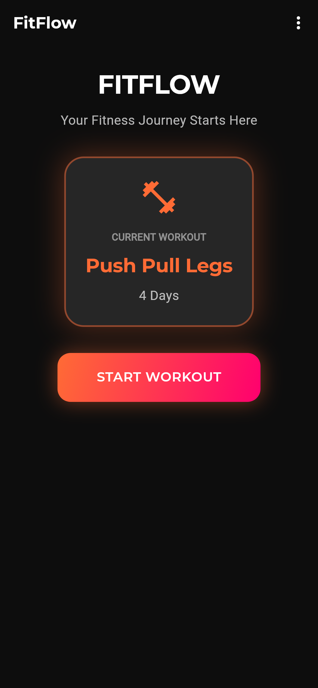
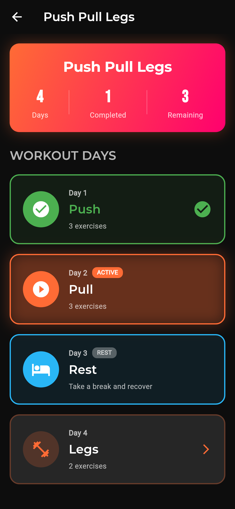
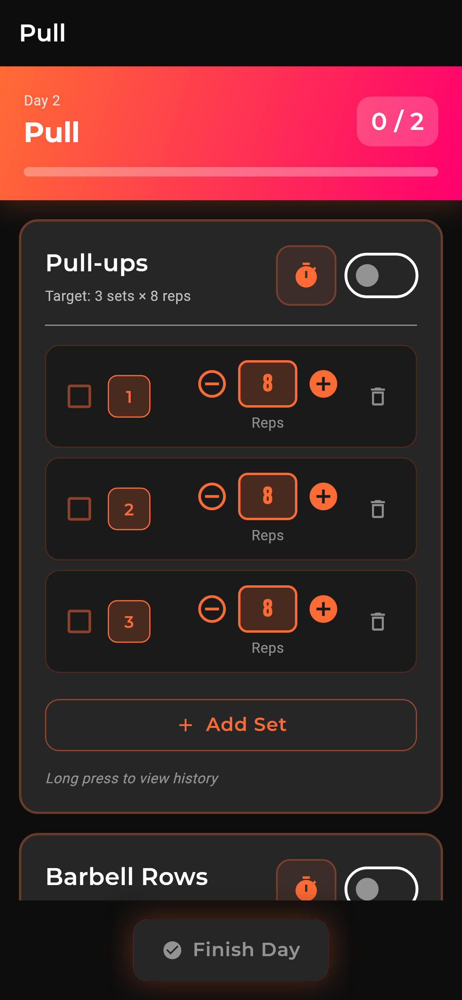
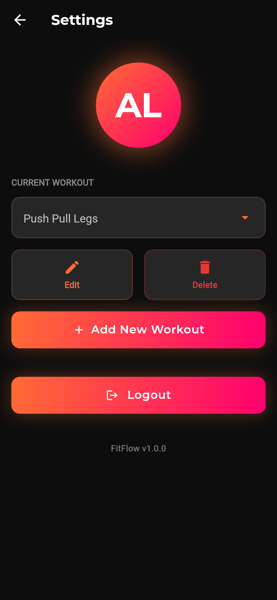

# FitFlow

[](https://github.com/Codenator81/fit_flow/actions/workflows/ci.yml)
[](https://codenator81.github.io/fit_flow/)

An offline-first workout tracker built with Flutter and Firebase. Plan a training program of days and rest days, run each day set by set with a rest timer, and keep your history in sync across devices, even without signal.

**Documentation site: https://codenator81.github.io/fit_flow/**

<p>
  
  
  
  
  
</p>

## Features

- Google sign-in; each user sees only their own data.
- Workout programs made of training days and rest days, with exercises (sets, reps, rest time).
- Day-by-day flow: finish a day and the next one becomes active; start the cycle over at any time.
- Per-set tracking with editable reps, a vibrating rest timer, and the last five results per exercise.
- Works offline: Cloud Firestore persistence with unlimited cache.

## Quick start

```bash
flutter pub get
flutter run
```

Requires Flutter 3.47.7 and an Android device or emulator. Google sign-in needs your debug key's SHA-1/SHA-256 registered in Firebase; see [Firebase](docs/architecture/firebase.md).

Before pushing:

```bash
dart format . && flutter analyze --fatal-infos && flutter test
```

## Documentation

| Page | What's inside |
|---|---|
| [Product spec](docs/product/index.md) | Purpose, users, user stories, features, requirements |
| [Screens](docs/product/screens.md) | Every screen with its screenshot |
| [Roadmap](docs/product/roadmap.md) | What's planned next |
| [Architecture](docs/architecture/index.md) | Layers, data flow, dependency injection, code generation |
| [Data model](docs/architecture/data-model.md) | Workout, day, exercise and the Firestore document |
| [Firebase](docs/architecture/firebase.md) | Project, rules, index, Google sign-in setup |
| [Decisions](docs/architecture/decisions.md) | Architecture decision records |
| [Getting started](docs/development/index.md) | Setup and everyday commands |
| [Testing](docs/development/testing.md) | Unit, golden and emulator tests |
| [CI & quality](docs/development/ci.md) | Workflows, PR comments, branch protection |
| [Contributing](docs/development/contributing.md) | Issue → branch → PR → merge |
| [Changelog](docs/changelog.md) | What changed and when |

The site is built from `docs/` with [MkDocs Material](https://squidfunk.github.io/mkdocs-material/) and deployed to GitHub Pages on every merge to `master`.

## Tech stack

Flutter · flutter_bloc · Freezed + json_serializable · get_it · dartz · Firebase Auth · Cloud Firestore · google_fonts · vibration
