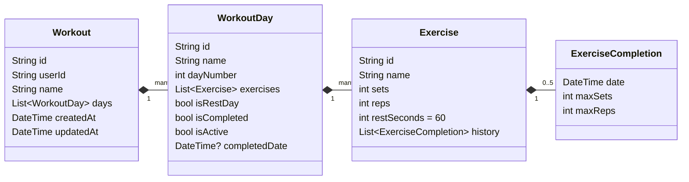

# Data model

A user's training program is one **Workout** document. Days and exercises are stored inside it as arrays, so a whole program is read and written in one request and works well with the offline cache.



## Entities and models

- **Entities** (`lib/features/workouts/domain/entities/`) are immutable Freezed classes used by the bloc and the UI.
- **Models** (`lib/features/workouts/data/models/`) mirror the entities with `json_serializable` and convert with `toEntity()` / `fromEntity()`.

## Firestore document

Collection `workouts`, one document per program, auto-generated id. Dates are stored as ISO-8601 strings.

```json
{
  "userId": "<firebase auth uid>",
  "name": "Push Pull Legs",
  "createdAt": "2026-10-01T00:00:00.000Z",
  "updatedAt": "2026-10-01T00:00:00.000Z",
  "days": [
    {
      "id": "1760000000000",
      "name": "Pull",
      "dayNumber": 2,
      "isRestDay": false,
      "isCompleted": false,
      "isActive": true,
      "completedDate": null,
      "exercises": [
        {
          "id": "1760000000001",
          "name": "Deadlift",
          "sets": 3,
          "reps": 5,
          "restSeconds": 90,
          "history": [
            { "date": "2026-10-01T00:00:00.000Z", "maxSets": 3, "maxReps": 5 }
          ]
        }
      ]
    }
  ]
}
```

## Day state rules

These rules live in `WorkoutRepositoryImpl`:

| Action | Effect |
|---|---|
| Add day | Appended with `dayNumber = days + 1`; not active, not completed |
| Delete day | Removed; remaining days are renumbered 1…n |
| Finish day | Saves each exercise's result at the top of its `history` (keeps the last 5), marks the day completed with `completedDate`, and makes the next unfinished day active |
| Mark rest day complete | Same as finish, without history |
| Start workout over | All days uncompleted; the first day becomes active |
| Set active day | Only that day is active; it is reopened if it was completed |
