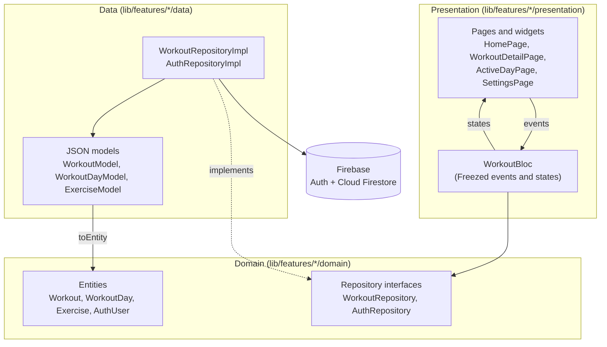
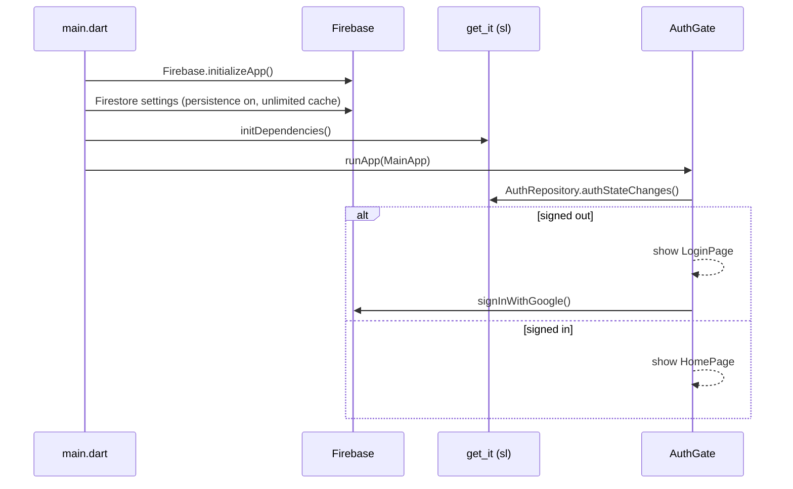
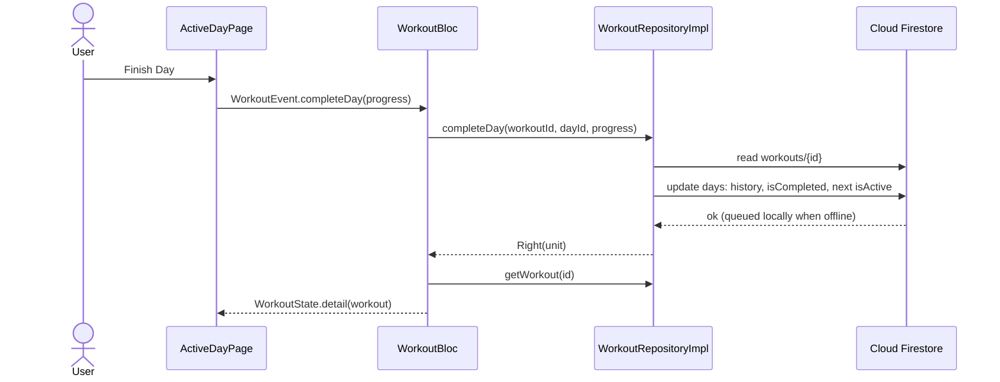

# Architecture

FitFlow is a Flutter app organised by **feature**, and inside each feature by **layer** (data, domain, presentation). The UI talks to a bloc, the bloc talks to a repository interface, and only the repository implementation knows about Firebase.

## Layers



| Layer | What lives there | Rule |
|---|---|---|
| Presentation | Pages, widgets, `WorkoutBloc` | Never imports the data layer; gets dependencies from `sl` |
| Domain | Entities (workout entities use Freezed), repository interfaces, `Failure` types | Pure Dart; no Flutter or Firebase imports |
| Data | Repository implementations, JSON models | The only layer that touches Firebase |

Repositories return `Either<Failure, T>` from `dartz`; failures (`ServerFailure`, `AuthFailure`, `CacheFailure`) carry a message that the bloc turns into an error state.

## Folder structure

```text
lib/
├── core/
│   ├── error/failures.dart        # Failure types
│   └── theme/                     # AppColors, AppTextStyles, AppSpacing, AppRadius, AppTheme
├── features/
│   ├── auth/                      # AuthRepository, Google sign-in, AuthGate, LoginPage
│   ├── home/                      # HomePage
│   ├── settings/                  # SettingsPage
│   └── workouts/                  # entities, models, WorkoutRepository(Impl), WorkoutBloc, pages
├── injection_container.dart       # get_it registrations (sl)
└── main.dart                      # Firebase init, offline persistence, MainApp
```

## Startup and auth flow



`AuthGate` subscribes to the auth stream once and swaps between `LoginPage` and `HomePage`, so signing in or out anywhere in the app updates the screen.

## Data flow of a training day



Every `WorkoutEvent` maps to one repository method: `loadWorkouts`, `createWorkout`, `deleteWorkout`, `loadWorkoutDetail`, `addDay`, `deleteDay`, `addExercise`, `completeDay`, `markRestDayComplete`, `resetWorkout`, `setActiveDay`. States are `initial`, `loading`, `loaded(workouts)`, `detail(workout)` and `error(message)`.

## Dependency injection

`lib/injection_container.dart` exposes the `get_it` locator as `sl`:

- `initDependencies()` registers `FirebaseAuth`, `FirebaseFirestore`, `GoogleSignIn`, `AuthRepository` and `WorkoutRepository` as lazy singletons, then calls `registerPresentation()`.
- `registerPresentation()` registers `WorkoutBloc` as a factory (a new bloc per page that provides one).

Tests call `registerFakeDependencies()` instead, which registers in-memory fakes and the same blocs. That is what lets the [golden tests](../development/testing.md) render screens behind the login without Firebase.

## Code generation

| Generator | Used for | Output |
|---|---|---|
| Freezed | Domain entities, `WorkoutEvent`, `WorkoutState` | `*.freezed.dart` |
| json_serializable | Data models (`WorkoutModel`, `WorkoutDayModel`, `ExerciseModel`) | `*.g.dart` |

Generated files are committed. After changing a model, entity, event or state run:

```bash
dart run build_runner build --delete-conflicting-outputs
```

!!! warning "CI does not run build_runner"
    A green CI on a generator upgrade only proves that the old generated code still compiles. Regenerate locally and review the diff.

## Theme

The design system lives in `lib/core/theme/`: a dark Material 3 theme with vibrant orange (`#FF6B35`) as the primary color, `AppTextStyles` built on Google Fonts (Montserrat headings, Roboto body, Bebas Neue numbers), and spacing/radius scales. The font files are bundled in `google_fonts/`, so the app and the tests never download fonts.

## Known gaps

- There is no `usecases/` layer yet: `WorkoutBloc` calls the repository directly.
- Data is loaded with one-shot reads (`get()`), and the bloc reloads after each change; real-time listeners are not used.
- `go_router`, `dio`, `pretty_dio_logger` and `fl_chart` are declared in `pubspec.yaml` but not used yet (see the [roadmap](../product/roadmap.md)).
