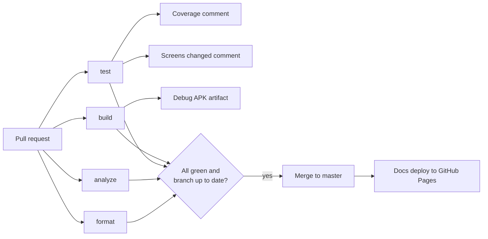

# CI and quality

All automation runs in GitHub Actions. Workflow files are in `.github/workflows/`.

## CI (`ci.yml`)

Runs on every pull request and on every push to `master`. A new push to the same PR cancels the previous run.

| Job | What it does |
|---|---|
| `format` | `dart format --set-exit-if-changed .` |
| `analyze` | `flutter analyze --fatal-infos` (infos fail the build too) |
| `test` | `flutter test --coverage`; comments the coverage (generated code excluded) and the changed golden screenshots on the PR |
| `build` | `flutter build apk --debug` on Java 17; uploads `app-debug-apk` (kept 14 days) |

The Flutter version comes from `pubspec.yaml`, and the Flutter SDK, pub packages and Gradle are cached.

### PR comments

- **Test coverage**: total and per-file line coverage, updated on each push.
- **Screens changed in this PR**: every added or changed golden PNG with *before* and *after* images. The Files changed tab also offers swipe and onion-skin diffs for images.

## Emulator tests

`emulator.yml` boots an Android API 34 emulator (Pixel 6 profile, cached snapshot) and runs the [integration tests](testing.md#emulator-integration-tests).

- **Runs:** manually (Actions → Emulator tests → Run workflow), every Monday at 06:00 UTC, and on PRs that change the workflow or the integration test files.
- **Outputs:** `emulator-screenshots` and `emulator-logcat` artifacts, the screenshots in the run summary, and an **Emulator screenshots** comment on the PR. The images are stored on the service branch `ci-screenshots` (not to be edited by hand).

## Documentation site (`docs.yml`)

Builds this site with `mkdocs build --strict` on pull requests that touch the docs, and deploys it to GitHub Pages on pushes to `master`.

## Dependabot

`.github/dependabot.yml` checks pub packages, GitHub Actions and the docs' Python packages weekly and opens update PRs.

## Protected `master`

A repository ruleset protects `master`:

- changes only through pull requests;
- the four CI checks (`format`, `analyze`, `test`, `build`) must pass;
- the branch must be up to date with `master` before merging (use **Update branch** on the PR);
- no bypass.

`CODEOWNERS` makes @Codenator81 the reviewer of every change.
