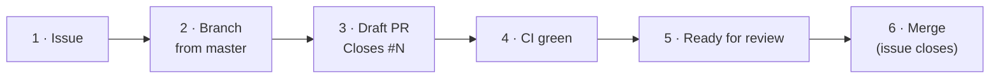

# Contributing

Every change follows the same path: **issue → branch → draft PR → green CI → review → merge**. Merging the PR closes the issue automatically.

## 1. Start with an issue

- Title in English, starting with an imperative verb: *Add …*, *Fix …*, *Update …* (about 70 characters at most).
- Body: what and why, plus acceptance criteria as bullets.
- Labels where obvious: `bug`, `enhancement`, `documentation`, `ci`, `dependencies`.
- Bugs on a screen include a screenshot of the broken state.

Dependabot PRs don't need an issue.

## 2. Branch

One task = one branch from `master` = one pull request.

| Prefix | For |
|---|---|
| `feat/` | New features |
| `fix/` | Bug fixes |
| `test/` | Tests only |
| `ci/` | Workflows |
| `tooling/` | Build and developer tooling |
| `chore/` | Maintenance |
| `docs/` | Documentation |

## 3. Open a draft pull request

The [PR template](https://github.com/Codenator81/fit_flow/blob/master/.github/pull_request_template.md) asks for:

1. `Closes #N`, so merging closes the issue.
2. **Summary**: 3–5 plain-language bullets a reviewer can read in 30 seconds.
3. **Why**, **How tested**, **Screenshots** (before/after for any UI change, embedded in the PR) and a **Checklist**.

Before pushing, run the [checks](index.md#everyday-commands): format, analyze, test, and `build_runner` if models changed.

## 4. Ready and merge

When CI is green the PR is marked *Ready for review*.

| PR type | Who merges |
|---|---|
| `feat/`, `fix/`, `docs/`, anything that changes app behaviour | The repository owner, after review |
| Dependabot, `chore/`, `ci/`, `tooling/` | May be merged by the author once all checks are green |

A PR with red or pending checks is never merged.

!!! tip "Keep the docs current"
    A PR that changes behaviour, setup or workflow also updates the matching page in `docs/`, and new user-facing changes get a line in the [changelog](../changelog.md).

## Code conventions

The full rules are in [`CLAUDE.md`](https://github.com/Codenator81/fit_flow/blob/master/CLAUDE.md). The essentials:

- State with `flutter_bloc`; no business logic in widgets.
- Repositories return `Either<Failure, T>`; the UI never touches Firestore directly.
- Freezed for entities, events and states; `json_serializable` for models; never hand-write `copyWith` or JSON.
- Register dependencies in `injection_container.dart`.
- Use `AppColors`, `AppTextStyles`, `AppSpacing`, `AppRadius`; never hardcode colors.
- No `print()`, no empty `catch`, no commented-out code, no secrets.
- Add unit tests for new logic and a golden for every screen change.
